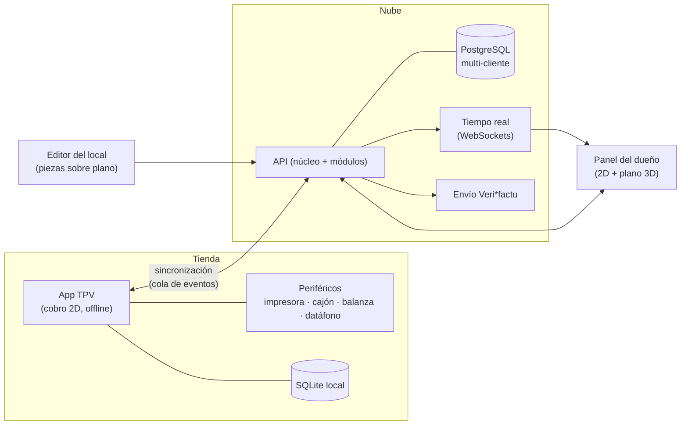
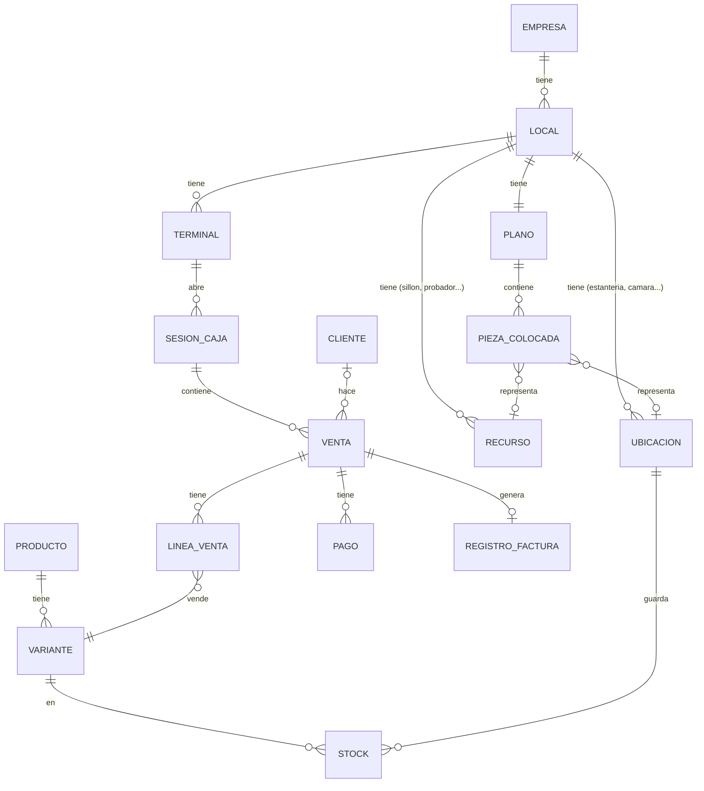

# TPV 3D: arquitectura

> [!warning] #revisar
> Primera propuesta de Claude (2026-10-16). Las decisiones abiertas están al final. Nada de esto está decidido hasta que Aaron lo apruebe.

## 1. Principios
1. **Un producto, muchos negocios.** Un único código base. Lo que cambia entre una frutería y una peluquería son **módulos de sector** y **configuración**, nunca un fork.
2. **El dominio no conoce la tecnología** (arquitectura hexagonal, de puertos y adaptadores): la lógica de vender, cobrar o facturar no sabe si hay PostgreSQL, SQLite, una impresora Epson o una pantalla 3D.
3. **El TPV funciona sin internet** (*offline-first*). En una tienda, si se cae la conexión, se sigue cobrando y se sincroniza después.
4. **Todo lo que pasa es un evento.** `VentaCerrada`, `StockBajo`, `CitaIniciada`… Los consumen el stock, la facturación, los informes y **el plano 3D**. El 3D es solo otro oyente: no complica el núcleo.
5. **Lo legal se diseña desde el día 1**: facturación inalterable (Veri\*factu) e impuestos por territorio (IVA, IGIC, IPSI).

## 2. Visión general



Hay tres aplicaciones de cara al usuario, todas sobre el mismo backend:

| App | Quién la usa | Tecnología propuesta |
|---|---|---|
| **TPV** | El dependiente | React + TypeScript dentro de **Electron** (acceso a periféricos y SQLite local) |
| **Panel del dueño** | El dueño o el encargado | React web, con el **plano 3D** (Three.js con React Three Fiber) |
| **Editor del local** | Tú, al dar de alta al cliente (más adelante, el propio cliente) | React + Three.js, dentro del panel |

## 3. Backend: núcleo y módulos

```text
backend/
├─ Nucleo/                 ← igual para todos los negocios
│  ├─ Catalogo/            productos, variantes, unidades, tarifas
│  ├─ Ventas/              tickets, líneas, descuentos, devoluciones
│  ├─ Caja/                apertura, cobros, arqueo, cierre
│  ├─ Facturacion/         series, registros encadenados (Veri*factu)
│  ├─ Impuestos/           IVA · IGIC · IPSI (estrategias)
│  ├─ Inventario/          ubicaciones, movimientos de stock
│  ├─ Recursos/            sillones, probadores, puestos (lo que se "ocupa")
│  ├─ Clientes/
│  └─ Identidad/           empresas, locales, terminales, usuarios, roles
├─ Modulos/                ← se activan por cliente
│  ├─ VentaPorPeso/        frutería, carnicería: balanza, precio/kg, taras
│  ├─ Agenda/              peluquería, estética: citas, profesionales, servicios
│  ├─ Variantes/           ropa, calzado: talla × color, cambios, vales
│  └─ ...                  (restauración: mesas y comandas, en el futuro)
└─ Plano/                  escena 3D del local y vínculos pieza ↔ entidad
```

Cada carpeta del núcleo se organiza en capas hexagonales:

```text
Ventas/
├─ Dominio/         entidades (Venta, LineaVenta), reglas, eventos, puertos (interfaces)
├─ Aplicacion/      casos de uso: AbrirVenta, AnadirLinea, Cobrar, Devolver
└─ Infraestructura/ repositorios Eloquent, controladores HTTP, adaptadores
```

### Cómo se engancha un módulo
Un módulo **no modifica el núcleo**: se registra en los **puntos de extensión** que el núcleo ofrece.

| Punto de extensión | Qué aporta un módulo | Ejemplo |
|---|---|---|
| `CalculadorPrecioLinea` (Strategy) | Cómo se calcula el precio de una línea | VentaPorPeso: `kg × €/kg − tara` |
| `TipoProducto` | Campos extra del producto | Variantes: talla y color · Agenda: duración del servicio |
| Oyentes de eventos (Observer) | Reaccionar a lo que pasa | Agenda: al cobrar una cita, la marca como completada |
| `TipoRecurso` | Cosas que se ocupan | Agenda: sillón, profesional |
| Pantallas del TPV y del panel | Componentes de interfaz | Agenda: calendario · VentaPorPeso: lectura de la balanza |
| Piezas del plano | Piezas 3D del catálogo | Agenda: sillón de peluquería · Variantes: burro de ropa |

Cada cliente tiene su **lista de módulos activos** y sus **opciones** (*feature flags*). Las "especificaciones del usuario" se resuelven aquí; solo se programa algo nuevo cuando una especificación no cabe en ningún punto de extensión.

## 4. Modelo de datos (núcleo)



**La clave del 3D genérico:** el plano no sabe nada de fruterías ni de peluquerías. Solo sabe que una **pieza colocada** representa una **ubicación** (donde hay stock) o un **recurso** (algo que se ocupa). El color de la pieza sale del estado de esa entidad. Así, el mismo motor 3D sirve para cualquier negocio.

**Multi-cliente:** una sola base de datos PostgreSQL con `empresa_id` en cada tabla y **Row Level Security**, para que una empresa no pueda ver nunca los datos de otra aunque haya un fallo en el código.

## 5. TPV offline y sincronización
- El TPV guarda todo en **SQLite local** y apunta cada operación en una **cola de salida** (patrón *outbox*).
- Con conexión, la cola se envía a la API en orden. Los identificadores son **UUID generados en el terminal**, así que no chocan entre terminales.
- **Facturación:** cada terminal tiene **su propia serie** y encadena las huellas de sus registros localmente. Así se puede facturar sin conexión y el envío a la AEAT se hace al sincronizar. ⚠️ Hay que validarlo con la especificación técnica oficial de Veri\*factu antes de implementarlo.
- Lo que baja de la nube al TPV: catálogo, precios, usuarios y configuración. En los datos maestros gana siempre la nube; en las ventas no hay conflicto, porque solo se añaden y nunca se editan.

## 6. Plano 3D

**Editor paramétrico** (decisión 2 de [[TPV 3D]]):
1. Se dibuja la planta del local en 2D sobre una cuadrícula: paredes, puerta y medidas.
2. Se arrastran piezas del **catálogo** (modelos glTF reutilizables con parámetros: ancho, número de baldas, color).
3. Cada pieza se **vincula** a una ubicación o a un recurso.
4. Se guarda como **JSON** (`plano.json`): es la "escena" del cliente.

**Visor en vivo** (panel del dueño):
- Lee `plano.json` y el estado actual, y se suscribe por WebSockets a los eventos del local.
- Reglas de color configurables: estantería en rojo si el stock < mínimo; sillón en ámbar si la cita va con retraso; probador ocupado más de 15 min…
- Al hacer clic en una pieza se abre su panel 2D (stock, ventas del día, próxima cita).
- Capas que se pueden activar: stock, ocupación y mapa de calor de ventas por zona.

## 7. Patrones de diseño (para [[Diseño del Software]])

| Patrón | Dónde |
|---|---|
| **Puertos y adaptadores** | Todo el backend; periféricos del TPV |
| **Strategy** | Cálculo de precio por línea, impuestos (IVA/IGIC/IPSI), reglas de color del 3D |
| **Adapter** | Impresoras ESC/POS, balanzas, datáfonos, envío a la AEAT |
| **Observer / eventos de dominio** | Stock, facturación, 3D y notificaciones reaccionan a las ventas |
| **State** | Ciclo de vida de la venta (abierta → cobrada → devuelta / anulada) y de la cita |
| **Command** | Acciones del TPV (añadir línea, descuento, anular), que se pueden deshacer y van a la cola *outbox* |
| **Repository** | Acceso a datos, igual con PostgreSQL o SQLite |
| **Registry / plugin** | Registro de módulos y de sus puntos de extensión |
| **Composite** | Escena 3D (local → zonas → piezas) |
| **Factory** | Creación de piezas 3D a partir del catálogo y sus parámetros |

## 8. Repositorio (monorepo)

```text
tpv-3d/
├─ apps/
│  ├─ api/          Laravel 12
│  ├─ tpv/          React + Electron
│  └─ panel/        React (panel + plano 3D + editor)
├─ packages/
│  ├─ ui/           componentes comunes (Tailwind + shadcn/ui)
│  ├─ dominio-ts/   tipos y reglas compartidas en el cliente (precio, impuestos)
│  ├─ plano-3d/     motor del plano: catálogo, escena, reglas de color
│  └─ sdk/          cliente tipado de la API
└─ docs/            requisitos, decisiones (ADR), diagramas
```

Es el mismo stack que en [[Aularis]] (Laravel, React, Electron, PostgreSQL), así que se aprovecha todo lo que ya sabes.

## 9. Hoja de ruta
1. **Requisitos** del primer sector y del núcleo (casos de uso, [[Introducción a la Ingeniería de Software|IIS]]).
2. **MVP del núcleo + Agenda (peluquería)**: venta, cobro, caja, ticket e impuestos, sin 3D.
3. **Offline** y sincronización.
4. **Plano 3D**: primero el visor con un `plano.json` hecho a mano; después el editor.
5. **Facturación Veri\*factu** completa, contrastada con la norma.
6. **Segundo módulo (VentaPorPeso)**: si hace falta tocar el núcleo, se corrige la arquitectura.

## 10. Decisiones abiertas (#revisar)
- [ ] ¿Confirmas el stack (Laravel + React + Electron + PostgreSQL) o prefieres otro?
- [ ] ¿TPV en Electron (PC con periféricos) o también tablet (PWA o Android)?
- [ ] ¿Primer sector: peluquería?
- [ ] ¿Multi-cliente con base compartida + RLS, o una base por cliente?
- [ ] Nombre definitivo del proyecto.
