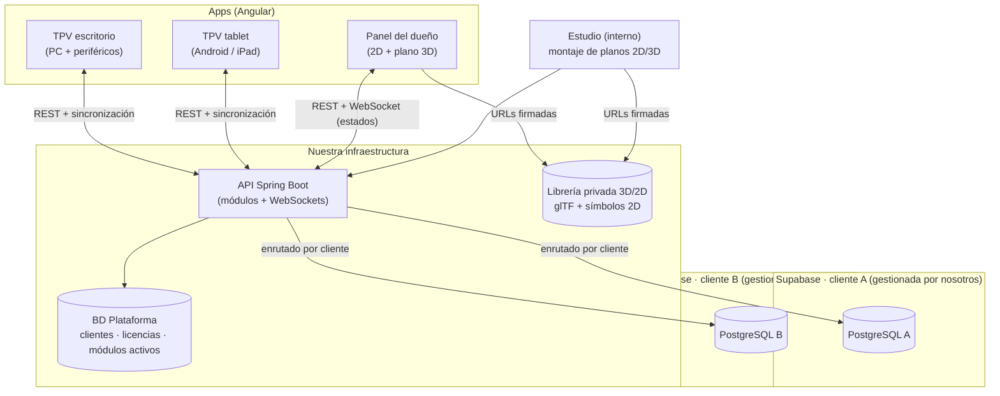
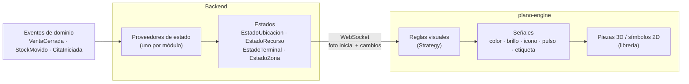

# Twinpos: arquitectura (v2)

> [!info] Fase: notas e ideas
> No hay código todavía. Las decisiones que ya ha tomado Aaron están en [[Twinpos#Decisiones (confirmadas por Aaron el 2026-10-16)|TPV 3D › Decisiones]]. Todo lo demás es propuesta de Claude (#revisar). La v1 (Laravel) está archivada en `ARCHIVO/GITHUB/`.

## 1. Principios
1. **Un producto y un catálogo de módulos** (estilo Odoo). Al cliente se le activan solo los módulos que necesita; nunca se hace un fork por cliente.
2. **Arquitectura hexagonal**: el dominio no sabe que existen Supabase, la impresora, Angular o el 3D.
3. **Offline-first**: el TPV cobra aunque se caiga internet.
4. **Todo lo que pasa es un evento**: stock, facturación, informes y el plano 3D son oyentes.
5. **El 3D no entiende de negocio**: los modelos solo reflejan **estados** que calculan otras clases.
6. **Una sola escena para dos vistas**: la plantilla 2D y el 3D salen del mismo documento de plano.
7. **Lo legal va dentro del diseño**: Veri\*factu e impuestos por territorio (IVA, IGIC, IPSI).

## 2. Modelo de negocio (lo que se vende)

| Concepto | Qué incluye |
|---|---|
| **Licencia base** | Módulos obligatorios (núcleo TPV, caja, catálogo, impuestos, facturación, usuarios) |
| **Módulos opcionales** | Cada uno con su precio: inventario, agenda, balanza, variantes… |
| **Plano 2D/3D** | El cliente entrega su plano y nosotros montamos la escena con la librería estándar |
| **Objetos premium o a medida** | Objetos fuera de la librería estándar o modelados para ese cliente: coste extra, tanto en 2D como en 3D |
| **BD gestionada** | Cuota de mantenimiento: copias, actualizaciones, monitorización y soporte |
| **BD del cliente** | El cliente tiene las credenciales de administrador y la gestiona él; sin cuota, con límites de soporte |

## 3. Visión general



### Las dos modalidades de base de datos
Para poder dar credenciales de administrador, **cada cliente tiene su propio proyecto de Supabase** (una BD por cliente). En una BD compartida no se pueden dar esas credenciales sin enseñar los datos de los demás.

| | **Gestionada por nosotros** | **Gestionada por el cliente** |
|---|---|---|
| Proyecto de Supabase | En **nuestra** organización | En la organización **del cliente** (paga él a Supabase) |
| Credenciales de administrador | Nosotros | El cliente; nosotros tenemos un **rol limitado** para migraciones |
| Migraciones | Automáticas en cada versión | Automáticas con nuestro rol; si fallan, avisamos |
| Copias y monitorización | Incluidas en la cuota | Cosa del cliente |
| Cambio de modalidad | Se transfiere el proyecto de una organización a otra (hay que comprobar cómo lo permite Supabase hoy) | |

**Protecciones** para cuando el cliente tiene acceso de administrador:
- Esquema **`ext`** propio del cliente: ahí puede crear lo que quiera. Si toca los esquemas de la aplicación, pierde el soporte (cláusula del contrato).
- Al arrancar, la API comprueba la **versión del esquema** (Flyway). Si no cuadra, el cliente queda en modo aviso y no se rompe en silencio.
- Los registros de facturación van **encadenados con huellas**: si alguien los modifica a mano, la cadena lo delata.

**Qué usamos de Supabase**: **PostgreSQL** y **Storage** (fotos y planos originales). La autenticación y el tiempo real los lleva **Spring**, porque así el dominio no depende de Supabase y una BD de cliente podría ser cualquier PostgreSQL.

> [!warning] Por comprobar
> Los planes de Supabase (proyectos gratuitos limitados y que se pausan si no hay actividad) obligan a que **cada cliente tenga un proyecto de pago**. Hay que meter ese coste en el precio. Revisar las tarifas actuales.

## 4. Backend: Spring Boot hexagonal

### ¿Spring Boot o Laravel?
Los dos sirven, pero **Spring encaja mejor con la hexagonal**:
- Las interfaces de Java son los **puertos** de forma natural, y la inyección de dependencias conecta los **adaptadores**.
- Con **módulos Maven** se puede **impedir físicamente** que el dominio importe la infraestructura. En Laravel solo es una convención.
- Eloquent es *Active Record*: la entidad y la BD van pegadas, justo lo contrario de lo que pide la hexagonal.
- **Spring Modulith** da módulos con límites verificados, eventos entre módulos y documentación generada. Encaja con lo de "estilo Odoo".
- **ArchUnit**: tests que fallan si alguien rompe las capas.
- Además lo usas a diario y Java + Angular está muy demandado.

### Estructura de un módulo

```text
modulo-ventas/
├─ domain/                    ← Java puro, sin Spring
│  ├─ model/                  Venta, LineaVenta, Importe (value object)
│  ├─ event/                  VentaCerrada, VentaDevuelta
│  └─ service/                reglas que no son de una sola entidad
├─ application/
│  ├─ port/in/                CobrarVentaUseCase, AnadirLineaUseCase
│  ├─ port/out/               VentaRepository, ImpresoraTickets, RegistroFiscal
│  └─ service/                implementación de los casos de uso
└─ adapter/
   ├─ in/web/                 controladores REST, DTO
   ├─ in/sync/                recepción de la cola offline
   └─ out/persistence/        JPA/JDBC contra Supabase
```

### Multi-cliente
- La **BD Plataforma** (nuestra) guarda los clientes, las licencias, los módulos activos y los **datos de conexión cifrados** de la BD de cada cliente.
- Cada petición lleva el cliente en el token, y un `DataSource` enrutado (`AbstractRoutingDataSource`) apunta a su Supabase.
- Los secretos de conexión van en un almacén de secretos, nunca en claro en la BD.

## 5. Módulos estilo Odoo

### Catálogo inicial

| Módulo | Tipo | Depende de | Qué aporta |
|---|---|---|---|
| `nucleo-tpv` | Base | — | Venta, líneas, cobro, ticket, devoluciones |
| `caja` | Base | nucleo-tpv | Apertura, arqueo, cierre, movimientos de efectivo |
| `catalogo` | Base | — | Productos, familias, tarifas |
| `impuestos` | Base | — | IVA / IGIC / IPSI y recargo de equivalencia |
| `facturacion` | Base | nucleo-tpv, impuestos | Series, facturas simplificadas y completas, Veri\*factu |
| `usuarios` | Base | — | Usuarios, roles, permisos, terminales |
| `inventario` | Opcional | catalogo | Ubicaciones, stock, movimientos, mínimos, mermas |
| `compras` | Opcional | inventario | Proveedores, pedidos, recepciones |
| `balanza` | Opcional | catalogo | Venta por peso, taras, etiquetas con precio |
| `variantes` | Opcional | catalogo | Talla × color, matrices de stock |
| `cambios-vales` | Opcional | nucleo-tpv | Vales de devolución, cambios de talla |
| `clientes` | Opcional | — | Fichas, historial, RGPD |
| `fidelizacion` | Opcional | clientes | Puntos, bonos, tarjetas regalo |
| `agenda` | Opcional | clientes, usuarios | Citas, servicios, recursos (sillones, cabinas) |
| `empleados` | Opcional | usuarios | Turnos, fichaje, comisiones |
| `mesas` | Opcional | nucleo-tpv | Restauración: mesas, comandas, cocina |
| `multi-local` | Opcional | — | Varias tiendas, traspasos de stock |
| `informes` | Opcional | — | Cuadros de mando avanzados |
| `datafono` | Opcional | caja | Integración con el terminal de tarjetas |
| `plano` | Opcional | — | Escena 2D/3D del local y estados en vivo |

**Packs por sector** (son solo preconfiguraciones de módulos):
- **Frutería**: base + inventario + balanza + compras
- **Peluquería**: base + clientes + agenda + empleados + fidelización
- **Ropa**: base + inventario + variantes + cambios-vales + clientes

### El manifiesto de un módulo
Como el `__manifest__` de Odoo, cada módulo se describe a sí mismo:

```yaml
id: agenda
version: 1.2.0
depende: [clientes, usuarios]
migraciones: db/migration/agenda      # Flyway, se aplican al activar el módulo
permisos: [agenda.ver, agenda.editar]
eventos_publica: [CitaCreada, CitaIniciada, CitaCompletada]
eventos_escucha: [VentaCerrada]
estados_plano: [RECURSO]              # qué estados aporta al motor 3D
frontend: { ruta: /agenda, menu: "Agenda", widgets: [proximas-citas] }
```

- **Activar** un módulo aplica sus migraciones y lo enciende para ese cliente.
- **Desactivar** solo lo apaga: los datos nunca se borran.
- La API rechaza las llamadas a módulos que no están activos, y el frontend ni siquiera los carga.

## 6. Frontend: Angular

### Por qué Angular aquí
Inyección de dependencias de verdad (como en Spring), estructura con opiniones, TypeScript estricto, **componentes standalone**, **signals** y carga diferida por rutas. Encaja con un catálogo de módulos que se activan por cliente.

### Monorepo (Nx)

```text
frontend/
├─ apps/
│  ├─ tpv/            TPV (PC con Electron · tablet con Capacitor)
│  ├─ panel/          panel del dueño, con el plano
│  └─ estudio/        herramienta interna para montar los planos
└─ libs/
   ├─ core/           auth, cliente HTTP, registro de módulos, sincronización offline
   ├─ ui/             sistema de diseño (componentes de presentación)
   ├─ hardware/       puertos y adaptadores de periféricos
   ├─ feature-*/      una lib por módulo: feature-ventas, feature-agenda…
   ├─ plano-engine/   motor 2D/3D en TypeScript + Three.js, sin Angular
   └─ plano-angular/  componentes Angular que envuelven el motor
```

### Patrones en el frontend
- **Componentes contenedor / presentación**: los contenedores hablan con los servicios; los de presentación solo reciben `input()` y emiten `output()`.
- **Fachadas** por módulo (`AgendaFacade`) que esconden el estado (signals) y la API.
- **Registro de módulos**: cada `feature-*` exporta un `ModuloDescriptor` (rutas, menú, permisos, widgets). La app solo registra los que vienen activos del backend, con `loadChildren` diferido.
- **Puertos de hardware con `InjectionToken`**: `IMPRESORA_TICKETS` → `EscPosUsbAdapter` (PC) / `EscPosBluetoothAdapter` (tablet) / `PdfAdapter` (pruebas). El mismo código de cobro sirve para PC y tablet.
- **Offline**: la interfaz `AlmacenLocal` tiene dos adaptadores, SQLite con Electron y SQLite con Capacitor, y una cola de salida (*outbox*) que se envía al recuperar la conexión.

### Tablet
- La misma app `tpv` empaquetada con **Capacitor** (Android y iPad) y diseño adaptable.
- Periféricos por Bluetooth o red (impresoras de tickets, datáfonos).
- El **panel con el plano 3D también funciona en tablet** (WebGL), con modelos simplificados (LOD) para no cargarla.

## 7. Motor 3D genérico (estados → señales → modelos)

La idea de Aaron, formalizada: **unas clases calculan los estados y los modelos 3D solo los leen**. Son tres capas:



1. **Estados** (backend): son clases de valor con lo necesario y nada más.
   - `EstadoUbicacion { stock, minimo, nivel: OK | BAJO | AGOTADO }`, que lo aporta `inventario`.
   - `EstadoRecurso { ocupado, desde, citaActual, retrasoMin }`, que lo aporta `agenda`.
   - `EstadoTerminal { cajaAbierta, ventasHoy }`, que lo aporta `caja`.
   - `EstadoZona { ventasHoy, intensidad }`, que lo aporta `informes`.

   Cada módulo implementa `ProveedorEstado<T>` y se registra solo. Si el módulo no está activo, no hay estado y la pieza sale neutra.
2. **Reglas visuales** (frontend, patrón Strategy): convierten un estado en **señales**. Por ejemplo, `nivel = BAJO` → ámbar con pulso lento. Las reglas se configuran por cliente sin tocar los modelos.
3. **Piezas**: los objetos de la librería implementan una sola interfaz, `Representable { aplicar(senales) }`. Una estantería no sabe qué es el stock: solo sabe ponerse en ámbar y latir.

Es un **MVVM**: el estado es el modelo, la regla visual el *view-model* y la pieza la vista. Gracias a eso, la misma estantería sirve en una frutería y en una zapatería, y un módulo nuevo puede alimentar al plano sin tocar el motor.

## 8. Planos y librería privada

### Flujo de trabajo
1. El cliente entrega su plano: PDF, DWG o foto con medidas.
2. En **Estudio** (app interna) lo calcamos y colocamos objetos de la librería.
3. Todo se guarda en un único **documento de escena** (`escena.json`, versionado), del que salen **las dos vistas**: la plantilla 2D (SVG) y el 3D (Three.js).
4. **Vinculamos** cada pieza a su entidad (estantería 3 → ubicación "Fruta de temporada"; sillón 2 → recurso "Sillón 2").
5. El cliente lo valida y se publica.

```json
{
  "version": 3,
  "local": "peluqueria-centro",
  "planta": { "ancho": 8.4, "fondo": 12.0, "muros": ["..."] },
  "piezas": [
    {
      "id": "p-07",
      "objeto": "sillon-peluqueria@1.3",
      "nivel": "estandar",
      "pos": [2.1, 0, 4.5], "rot": 90,
      "params": { "color": "#1d1d1d" },
      "vinculo": { "tipo": "RECURSO", "id": "sillon-2" }
    }
  ]
}
```

### Librería privada de objetos
Cada objeto incluye: **modelo 3D (glTF)** con sus variantes de detalle, **símbolo 2D**, **parámetros** (ancho, baldas, color), **qué vínculos admite** (UBICACION, RECURSO…), versión y **nivel comercial**:

| Nivel | Qué es | Precio |
|---|---|---|
| `estandar` | Catálogo base | Incluido en el plano |
| `premium` | Objetos más detallados o específicos | Extra |
| `a-medida` | Modelado para ese cliente (su mostrador, su marca) | Extra, solo de ese cliente |

**Protección de la propiedad intelectual**: los modelos viven en **nuestro** almacenamiento y se sirven con **URLs firmadas** a clientes con licencia. La escena del cliente (en su BD) solo guarda **referencias** (`sillon-peluqueria@1.3`), nunca los modelos. Aunque tenga acceso de administrador a su BD, no se lleva la librería.

## 9. Tiempo real
- **Spring WebSocket + STOMP**. Cada local tiene un canal: `/topic/local/{id}/estados`.
- Al conectarse se envía una **foto completa** de los estados y después solo los **cambios**.
- Lo usan el panel (plano y avisos) y el TPV (por ejemplo, la tablet de recepción ve que el sillón 2 ha quedado libre).

## 10. Seguridad y legal (primeras notas)
- **Spring Security** con JWT; los roles y permisos los define cada módulo en su manifiesto.
- **Veri\*factu**: registros encadenados con huellas, envío a la AEAT y **declaración responsable** del fabricante del software. Hay que estudiar la norma (RD 1007/2023 y la orden técnica) y las fechas vigentes de obligatoriedad.
- **Facturar sin conexión**: cada terminal tiene su serie y encadena sus registros localmente. Hay que validarlo con la especificación técnica.
- **RGPD**: los datos de clientes (agenda, fidelización) van en la BD del cliente, que es el responsable del tratamiento; nosotros somos el encargado en la modalidad gestionada.

## 11. Ideas para más adelante
- Mapa de calor de ventas por zona en el plano.
- Predicción de rotura de stock y de huecos en la agenda (IA).
- App o web para que los clientes finales reserven citas (enlaza con `agenda`).
- Kiosco de autoservicio usando el mismo `tpv`.
- Recorrido del plano en tablet (el dueño pasea por el local virtual).
- Cuadro de mando de **Plataforma** (nuestro): salud de las BD de todos los clientes, versiones y módulos. Un gemelo digital de nuestro propio negocio.

## 12. Decisiones tomadas (Aaron, 2026-10-16)
- [x] TPV de PC con **Electron**.
- [x] Backend con **Maven** como **monolito modular** (Spring Modulith): un módulo Maven por módulo funcional, y se podrá sacar alguno a microservicio más adelante si hace falta.
- [x] Las migraciones de un módulo se aplican **al activarlo**, como en Odoo: la BD de cada cliente solo tiene lo que usa.
- [x] El MVP empieza por el **pack de peluquería**.
- [x] Planos aceptados: **PDF o imagen a escala**, **fotos + medidas a mano** (más trabajo nuestro: se puede cobrar aparte) y **DWG/DXF** (requiere un importador DXF en Estudio).
- [x] **Precios: más adelante.** La estructura ya está en el §2; las cifras se fijarán después de estudiar la competencia y los costes de Supabase.

## 13. Pendiente
- [x] Nombre: **Twinpos** (2026-10-16). Falta comprobar que la marca (OEPM, EUIPO) y los dominios están libres.
