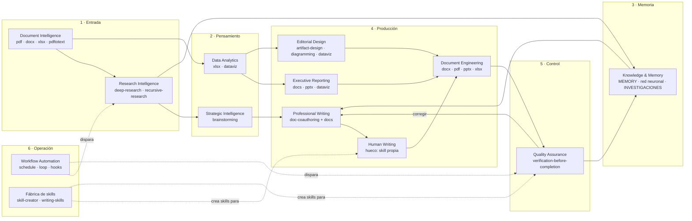

# Arquitectura de SKILLS PLANET (fase 4)

Los 12 departamentos se organizan en **6 capas por las que pasa el trabajo**: entrada, pensamiento, memoria, producción, control y operación. Cada departamento tiene una skill líder y otras de apoyo. Hay reglas para decidir qué skill usar cuando dos se solapan, y nada sale como definitivo sin pasar por la capa de control. Base: [[Selección (fase 3)]]. Centro: [[SKILLS PLANET]]. #revisar

## Mapa

## Capas y departamentos

| Capa | Departamento | Skill líder | Apoyo | Entrega a |
|---|---|---|---|---|
| 1 · Entrada | [[Document Intelligence]] | `pdf` | `docx`, `xlsx` (lectura), `pdftotext`, PyMuPDF (libros escaneados) | Research, Data Analytics |
| 1 · Entrada | [[Research Intelligence]] | `deep-research` | `recursive-research`, WebSearch, agente web-fetch | Strategic, Knowledge & Memory |
| 2 · Pensamiento | [[Strategic Intelligence]] | `brainstorming` | `deep-research` | Professional Writing |
| 2 · Pensamiento | [[Data Analytics]] | `xlsx` | `dataviz` | Executive Reporting, Editorial Design |
| 3 · Memoria | [[Knowledge & Memory]] | `AARON/MEMORY.md` + red neuronal | memoria automática, `AARON/INVESTIGACIONES/` | todas |
| 4 · Producción | [[Professional Writing]] | `doc-coauthoring` | `docs` | Human Writing |
| 4 · Producción | [[Human Writing]] | *skill propia (fase 6)* | `verification-before-completion` | Document Engineering |
| 4 · Producción | [[Document Engineering]] | `docx` | `docs`, `pdf`, `pptx`, `xlsx` | Quality Assurance |
| 4 · Producción | [[Editorial Design]] | `artifact-design` | `artifact-diagramming`, `dataviz` | Document Engineering |
| 4 · Producción | [[Executive Reporting]] | `docs` | `pptx`, `dataviz` | Document Engineering |
| 5 · Control | [[Quality Assurance]] | `verification-before-completion` | `code-review`, `simplify`, *revisión de documentos propia (fase 6)* | Knowledge & Memory (lo aprendido) |
| 6 · Operación | [[Workflow Automation]] | `schedule` | `loop`, `update-config` (hooks) | dispara cualquier capa |
| 6 · Operación | Fábrica de skills (transversal) | `skill-creator` | `writing-skills` | crea skills para los huecos |

## Reglas de elección (cuando dos skills se solapan)

| Si hay que… | Usa | Y no | Por qué |
|---|---|---|---|
| Investigar algo en una sesión (informe narrativo) | `deep-research` | `recursive-research` | Más rápida y con subagentes |
| Investigar a fondo, en varias sesiones, con fuentes clasificadas | `recursive-research` | `deep-research` | Guarda checkpoints en `AARON/INVESTIGACIONES/` y se reanuda |
| Un documento vivo que se revisa, comenta o comparte | `docs` | `docx` | Editable y exportable a Word o PDF |
| Rellenar una plantilla Word que exige alguien (p. ej. `PEC1-079.docx`) | `docx` | `docs` | Respeta el archivo original y su formato |
| Redactar un documento estructurado desde cero | `doc-coauthoring` como **proceso** + `docs`/`docx` como **soporte** | — | Se complementan, no se solapan |
| Diseñar algo nuevo (un sistema, un proyecto, un plan) | `brainstorming` | `doc-coauthoring` | Nunca las dos a la vez: serían dos rondas de preguntas |
| Un gráfico | `dataviz` | `artifact-design` | dataviz es la especialista en gráficos |
| Una página o un diagrama | `artifact-design` / `artifact-diagramming` | `dataviz` | |
| Revisar código | `code-review` / `simplify` | `verification-before-completion` sola | Las de código buscan fallos; la de verificación exige pruebas |
| Dar cualquier trabajo por terminado | `verification-before-completion` | — | Siempre, como puerta final |

> [!note] Regla del vault frente a `brainstorming`
> El vault pide actuar en cuanto hay información suficiente. `brainstorming` se usa solo cuando Aaron pide **diseñar o planificar algo nuevo** y faltan decisiones suyas; no en tareas cuyo resultado ya está claro.

## Mapa de compatibilidad (15 skills activas)

**✔** = se combinan (una entrega a la otra) · **≈** = se solapan: elegir con las reglas · **·** = independientes

| | docs | docx | pdf | pptx | xlsx | d-research | r-research | brainst. | coauth. | dataviz | art.-design | verif. | code-rev. | schedule | skill-cr. |
|---|---|---|---|---|---|---|---|---|---|---|---|---|---|---|---|
| **docs** | — | ≈ | ✔ | ✔ | ✔ | ✔ | ✔ | ✔ | ✔ | ✔ | ✔ | ✔ | · | ✔ | · |
| **docx** | ≈ | — | ✔ | · | ✔ | ✔ | ✔ | · | ✔ | ✔ | · | ✔ | · | ✔ | · |
| **pdf** | ✔ | ✔ | — | · | ✔ | ✔ | ✔ | · | ✔ | · | · | ✔ | · | · | · |
| **pptx** | ✔ | · | · | — | ✔ | · | · | · | · | ✔ | ✔ | ✔ | · | · | · |
| **xlsx** | ✔ | ✔ | ✔ | ✔ | — | · | · | · | · | ✔ | · | ✔ | · | ✔ | · |
| **deep-research** | ✔ | ✔ | ✔ | · | · | — | ≈ | ✔ | ✔ | · | · | ✔ | · | ✔ | · |
| **recursive-research** | ✔ | ✔ | ✔ | · | · | ≈ | — | ✔ | ✔ | · | · | ✔ | · | ✔ | · |
| **brainstorming** | ✔ | · | · | · | · | ✔ | ✔ | — | ≈ | · | ✔ | ✔ | · | · | ✔ |
| **doc-coauthoring** | ✔ | ✔ | ✔ | · | · | ✔ | ✔ | ≈ | — | ✔ | ✔ | ✔ | · | · | · |
| **dataviz** | ✔ | ✔ | · | ✔ | ✔ | · | · | · | ✔ | — | ≈ | ✔ | · | · | · |
| **artifact-design** | ✔ | · | · | ✔ | · | · | · | ✔ | ✔ | ≈ | — | ✔ | · | · | · |
| **verification** | ✔ | ✔ | ✔ | ✔ | ✔ | ✔ | ✔ | ✔ | ✔ | ✔ | ✔ | — | ✔ | ✔ | ✔ |
| **code-review** | · | · | · | · | · | · | · | · | · | · | · | ✔ | — | · | ✔ |
| **schedule** | ✔ | ✔ | · | · | ✔ | ✔ | ✔ | · | · | · | · | ✔ | · | — | · |
| **skill-creator** | · | · | · | · | · | · | · | ✔ | · | · | · | ✔ | ✔ | · | — |

`writing-skills` va siempre con `skill-creator`; `loop` y `update-config` se comportan como `schedule`; `artifact-diagramming` como `artifact-design`. **No hay conflictos (✖)** entre las skills activas.

## Convenciones

| Qué | Dónde | Estado |
|---|---|---|
| Documentos de la UNED | Carpeta de la asignatura y del tema (`UNED/AÑO n/…/TEMA n/`) | `#revisar` hasta que Aaron apruebe |
| Entregas en Word de la UNED | El `.docx` oficial de la actividad, relleno con `docx` | borrador previo en `docs` si hace falta revisar |
| Investigaciones largas | `AARON/INVESTIGACIONES/<slug>/` | checkpoints por ciclo |
| Lo que Claude aprende | `AARON/RED NEURONAL/` | sin `#revisar` (es para Claude) |
| Decisiones | `AARON/MEMORY.md` | solo hechos confirmados |
| Skills propias | `~/.claude/skills/<nombre>/` + nota en el planeta de su departamento | probadas con `writing-skills` |
| Estado de cada departamento | `estado` del planeta (`ok`, `aviso`, `inactivo`…) | se actualiza al instalar o quitar skills |

## Pendiente para la fase 6
- Crear la skill propia de **Human Writing** (escritura natural en español).
- Crear la skill propia de **revisión de documentos** (lista de comprobación del apartado 7 del encargo).
- Decidir si un hook lanza la revisión de calidad automáticamente (Workflow Automation).
